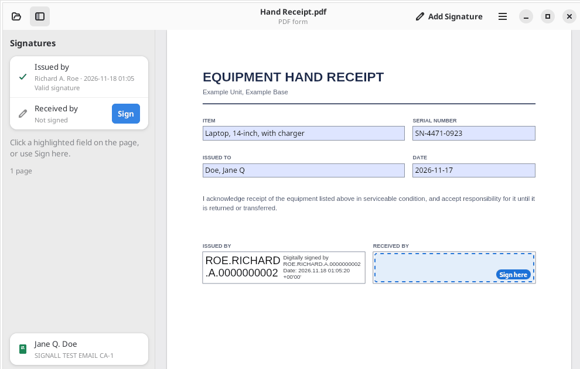

Signall is a GNOME app for signing PDFs with a US DoD Common Access Card (CAC) on Linux. Open a PDF, fill it in, click a signature field or draw a box, and enter your PIN. The signatures validate in Adobe Acrobat. A `signall` command-line tool is included for scripting.



It signs:

- **Any PDF:** draw a box where the signature goes.
- **PDF forms:** fill in the fields and sign in the form's own signature field.
- **XFA forms** such as DD Form 2875 (SAAR) and DD Form 2842, including forms that several people sign in turn. No other Linux tool can sign dynamic XFA forms.

Signatures carry the DoD certificate chain and revocation (OCSP) data, as Acrobat's do. The DoD root and intermediate certificates are bundled, so nothing else needs to be installed.

**Status:** early development. The command line has been tested with a real CAC on Fedora 40; the app is new and has so far been tested with a simulated card. See [docs/design.md](docs/design.md) for details and known gaps.

## Install

Signall needs Fedora 40 or newer (GNOME 46 or newer) and a CAC reader. Install it with:

```sh
sudo dnf copr enable elevate-systems/signall
sudo dnf install signall
```

Then open **Signall** from the app search. Updates arrive with your regular system updates, in GNOME Software or `dnf upgrade`. To uninstall, run `sudo dnf remove signall`. Each release, with its changes, is listed on the [releases page](https://github.com/elevatesystems/signall/releases).

The repository (on Fedora's [COPR](https://copr.fedorainfracloud.org/coprs/elevate-systems/signall/) service) covers the Fedora releases that are still supported, on x86_64 and ARM. On Fedora 40 to 42, install the release RPM instead; it doesn't update itself, so run the same command again for a new version:

```sh
sudo dnf install https://github.com/elevatesystems/signall/releases/latest/download/signall-latest.fc$(rpm -E %fedora).x86_64.rpm
```

If the smart card service isn't running yet, start it with `sudo systemctl enable --now pcscd.socket` (Fedora usually starts it on demand).

**From source**, for the latest unreleased changes: `git clone https://github.com/elevatesystems/signall.git && cd signall && ./install.sh`. The script installs what Signall needs and puts Signall itself in your home folder (`~/.local`). Run it again after `git pull` to update; `./install.sh --uninstall` removes it.

## Use the app

Open **Signall** from the app search, or right-click a PDF and choose **Open With → Signall**. You can also drag a PDF onto the window.

- **Fill in the form**, if it has one, by typing into it.
- **Sign a field:** click a highlighted signature field, or its **Sign** button in the sidebar.
- **Sign anywhere:** click **Add Signature**, then drag a box on the page. Dynamic XFA forms such as the DD 2875 only accept signatures in their own fields.
- **Enter your PIN** when asked. Signall then offers to save a signed copy named "*name* - signed.pdf"; the original is left unchanged.

The sidebar shows each signature field and whether existing signatures are valid. If the card isn't found, use **Check Smart Card** in the menu (see [Troubleshooting](#troubleshooting)).

Your PIN goes only to the card. Signall never stores or logs it.

## Use the command line

The `signall` command does the same things.

```sh
signall doctor                          # check the reader, card, certificates, and network
signall tokens                          # find the card and its signing certificate
signall inspect form.pdf                # list signature fields
signall sign form.pdf                   # sign the first empty field (asks for the PIN)
signall sign form.pdf --field Supervisor[0].Sig[0]               # sign a specific field
signall sign form.pdf --set form1.page1.Part1.Organization="My Org"   # fill a value, then sign
signall sign cert.pdf --box 1:180,78,373,114                     # draw a box on page 1
signall verify "form - signed.pdf"
```

- `--box PAGE:x0,y0,x1,y1` is in points (1/72 inch) from the bottom-left corner of the page.
- `--set` takes an XFA data path for XFA forms, or a field name for other PDF forms. Repeat it for each value.
- `--offline` signs without contacting the DoD revocation servers. The signature then lacks revocation data.
- `-o FILE` chooses the output file. By default it's "*name* - signed.pdf", and `--force` replaces an existing one.
- `verify` exits with 0 if every signature is valid, 1 if a signature is intact but not trusted, and 2 if one is invalid.

Run `signall COMMAND --help` for all options.

## Troubleshooting

Start with **Check Smart Card** in the app's menu, or `signall doctor`. It checks each step from the reader to the DoD servers and suggests a fix for each problem. Its report never includes your name or EDIPI, so you can paste it into a bug report.

Common causes:

- **pcscd isn't running:** `sudo systemctl enable --now pcscd.socket`.
- **A virtual machine has the reader:** virt-manager, GNOME Boxes, or VirtualBox may have the USB reader passed through to a VM. Give it back to the host, or shut the VM down.
- **GnuPG holds the reader:** `gpgconf --kill scdaemon`.
- **Wrong PIN:** the card locks after a few wrong tries, and only a CAC office (RAPIDS) can unlock it.

## Development

Report security problems privately; see [SECURITY.md](SECURITY.md).

To work on Signall, run it from the checkout instead of installing it:

```sh
python3 scripts/fetch-pdfjs.py
/usr/bin/python3 -m venv --system-site-packages .venv
.venv/bin/pip install -e ".[test]"
.venv/bin/signall-app
```

Use the system Python (`/usr/bin/python3`): it is the one that can see Fedora's GTK libraries. A Python from asdf, pyenv, or similar tools cannot.

To publish a release, set `__version__` in `src/signall/__init__.py`, add a `<release>` entry to `data/io.github.elevatesystems.Signall.metainfo.xml`, commit, then tag and push (`git tag v0.2.0 && git push origin v0.2.0`). The release workflow runs the tests, builds and test-installs an RPM for each Fedora release from 40 to the newest (`packaging/build-rpm.sh`), publishes them on the releases page, and builds the release in COPR. The Fedora list comes from `packaging/fedora-versions.py`, so a new Fedora is included without changes here.

`dev/run-tests.sh` runs the test suite in a Fedora 40 container with a virtual display and a SoftHSM2 token that behaves like a CAC. It needs Docker or Podman (with the `docker` command). `scripts/update-dod-certs.py` refreshes the bundled DoD certificates from DISA.

## License

MIT; see [LICENSE](LICENSE). pdf.js (downloaded at build time) is Apache-2.0.

Signall is an independent project. It is not affiliated with or endorsed by the Department of Defense, DISA, or Adobe.
